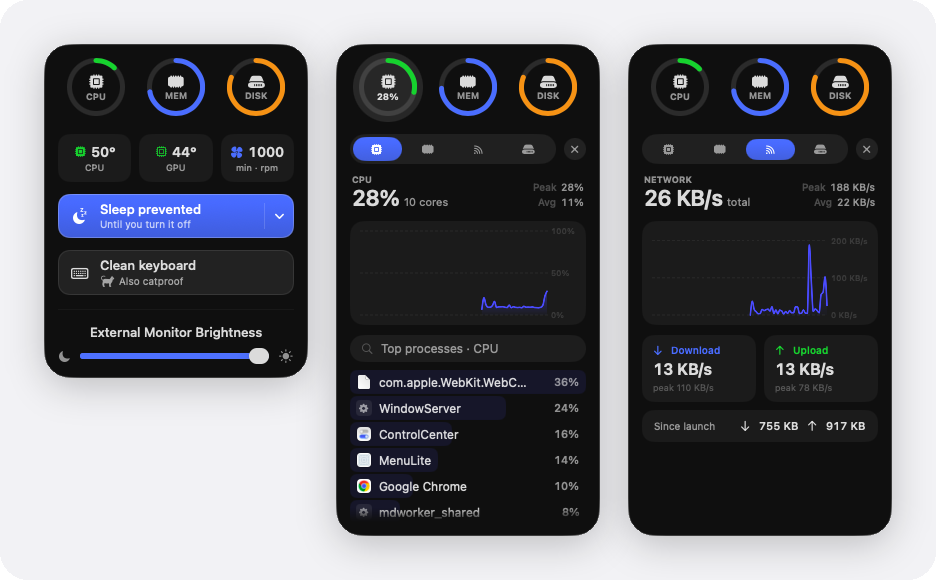

# MenuLite

A tiny native macOS menu-bar app: a system monitor plus a few handy toggles.
SwiftUI + AppKit, real Liquid Glass, no dependencies.

<p align="center">
  
</p>

## Features
- **System monitor** — CPU / memory / disk dials; click one for the live value
  with its peak and average, a smooth history chart, and the top processes (with
  their app icons and a share bar) — or download/upload and totals on the Network
  tab, and a capacity bar plus disk-I/O processes on Disk.
- **Quit a process inline** — hover any row in the process list, click the ✕, then **Quit** (SIGTERM) or **Force** (SIGKILL). Root-owned processes show a brief note instead of escalating.
- **Prevent sleep** — keeps your Mac awake (IOKit power assertion): until you turn
  it off, for 30 min – 4 h, or **until a process quits** (pick a build or training
  run from the busiest processes). Choose whether the screen stays on too. A small
  moon beside the menu-bar rings shows it's on, and it survives a relaunch.
- **Battery** (MacBooks) — charge, time to empty or full, power draw in watts,
  health and cycle count.
- **Dim external displays** — a brightness slider that overlays any external monitor.
- **Clean keyboard** — disables the keyboard so you can wipe it (needs Accessibility) —
  catproof, too.
- **Menu-bar readout** — right-click ▸ Menu Bar Shows: CPU %, memory %, CPU
  temperature, download speed or battery % beside the rings.
- **Shortcuts** — ⌃⌥M opens the panel, ⌃⌥S toggles Prevent sleep, ⌃⌥K starts keyboard cleaning, from anywhere
  (Carbon hot keys: no Accessibility needed). Toggle them in the right-click menu.

Right-click the menu-bar icon for these settings, **Launch at Login** and **Quit**.

## Build
```bash
./Scripts/build-app.sh && open dist/MenuLite.app
```
Requires **macOS 26 + Xcode 26** (uses the Liquid Glass APIs).

`swift Scripts/toggle-panel.swift [cpu|memory|network|disk]` opens the panel on a
given screen without clicking, which is how the preview above was captured.

## Permissions
**Clean keyboard** needs Accessibility — approve MenuLite in *System Settings ▸
Privacy & Security ▸ Accessibility* on first use. Nothing else needs permission.

© 2026 Ryan Truong. All rights reserved: the source is public to read, not to copy or reuse. See [LICENSE](LICENSE).
